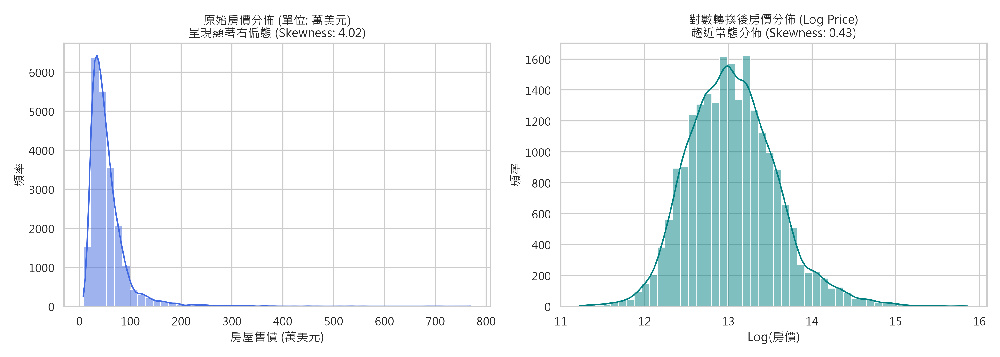
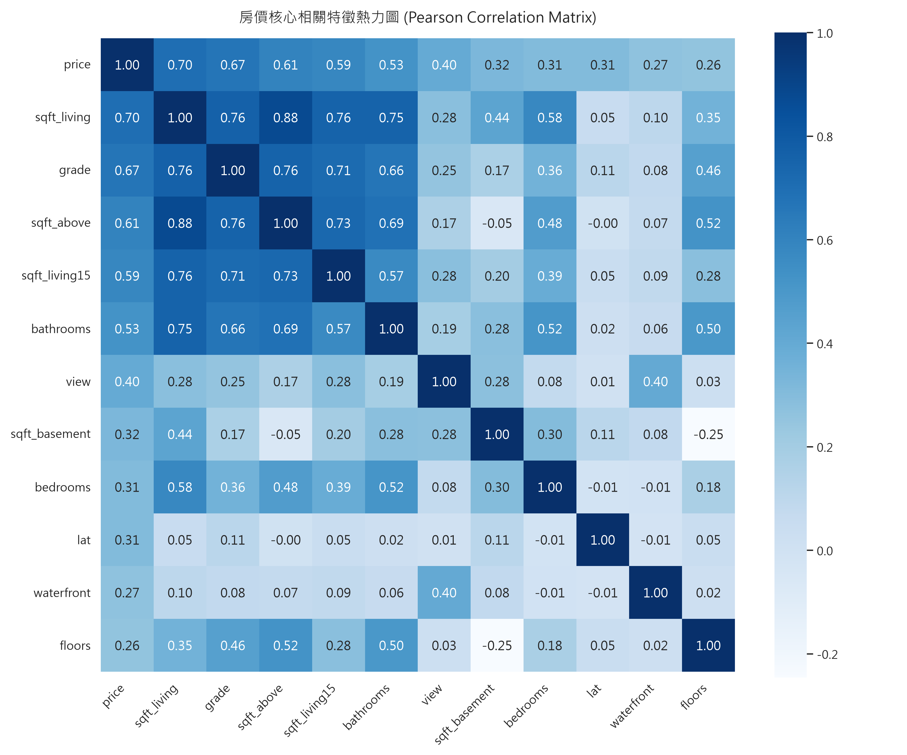
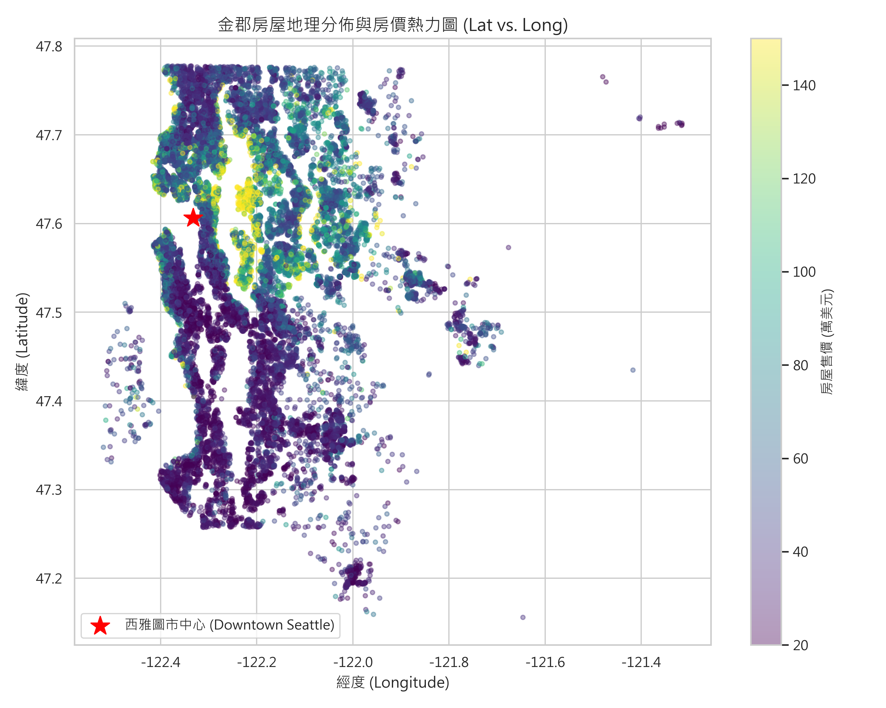
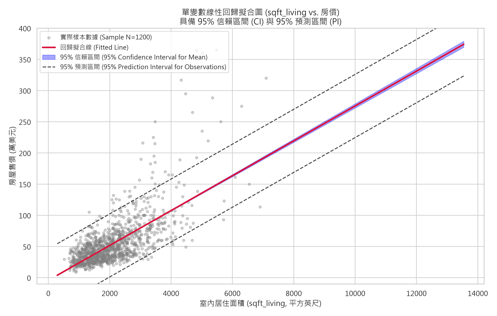
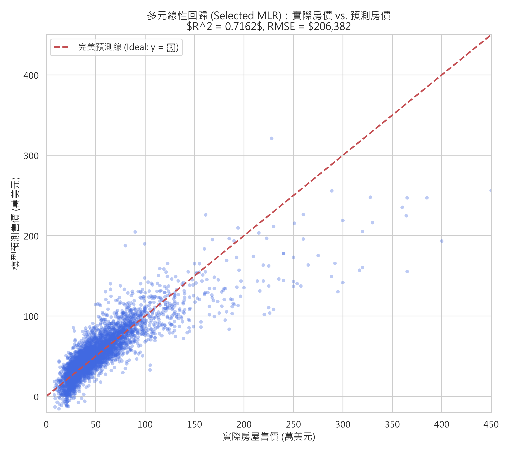
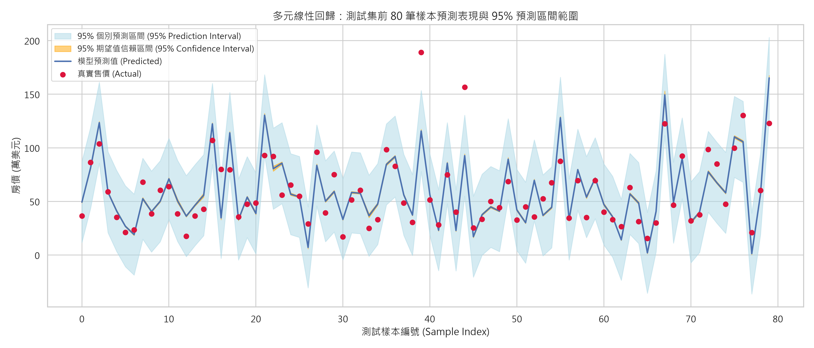
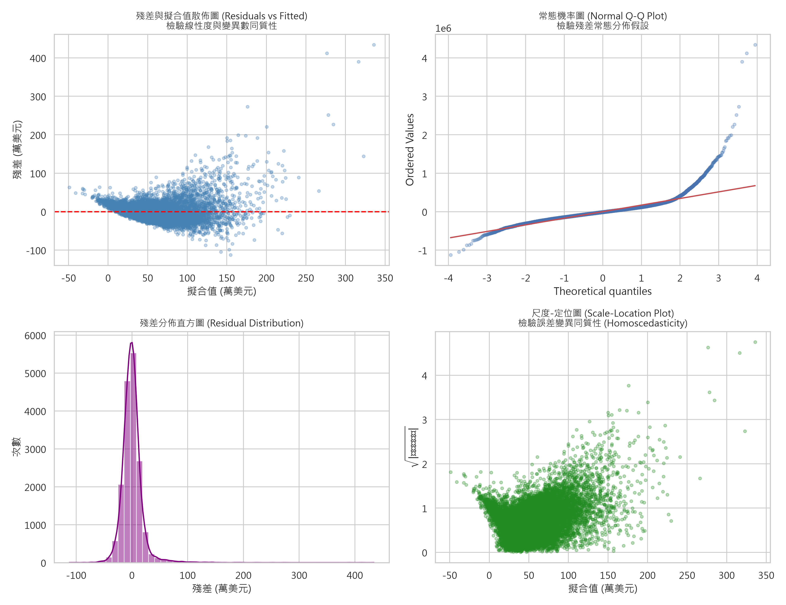
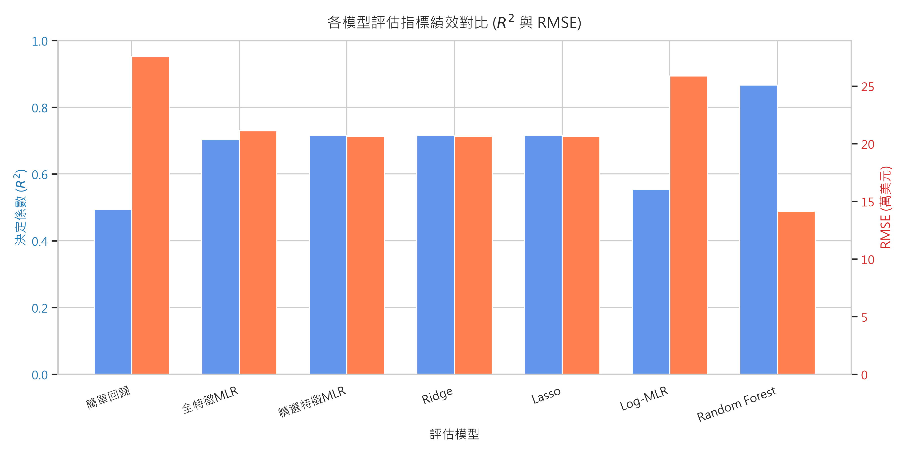
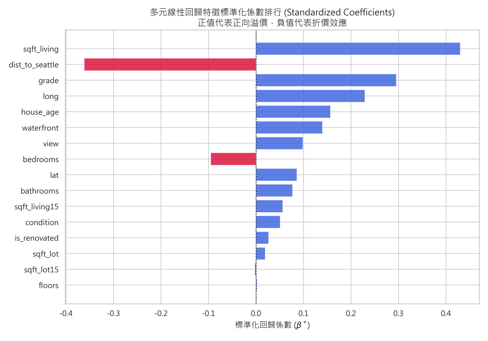

# AIoT_L3_CWA_HW2

## 巨量資料分析與機器學習 - 作業二 (HW2)
### 主題：基於 CRISP-DM 流程之金郡 (King County) 房價多元線性回歸完整分析

- **學生學號**：`7115056152` *(同學繳交前請確認學號)*
- **學生姓名**：學生姓名
- **資料集來源**：[Kaggle: House Sales in King County, USA](https://www.kaggle.com/datasets/harlfoxem/housesalesprediction)
- **分析任務**：多元線性回歸 (Multiple Linear Regression)、特徵選擇 (Feature Selection)、模型評估 (Model Evaluation)、95% 信賴區間與預測區間推導
- **遵循架構**：CRISP-DM (跨行業資料探勘標準流程) 六大階段
- **GitHub 專案庫**：[https://github.com/Richard5007/AIoT_L3_CWA_HW2](https://github.com/Richard5007/AIoT_L3_CWA_HW2)

---

## 一、專案檔案結構導覽

```text
7115056152_hw2/
│
├── kc_house_data.csv                   # Kaggle 原始金郡房價資料集 (21,613 筆，21 欄位)
├── 7115056152_hw2.py                   # 【主程式】Python 獨立執行腳本 (完整 CRISP-DM 流程)
├── 7115056152_hw2.ipynb                # 【主程式】Jupyter Notebook (格式完整、含輸出圖表與 Markdown)
├── 7115056152_hw2_Report.pdf           # 【正式報告】完整 CRISP-DM 分析與評估 PDF 報告 (7頁完整版)
├── 7115056152_hw2.pdf                  # 【正式報告】符合單一命名規則之 PDF 報告備份
├── GPT_Conversation_History.pdf        # 【AI輔助】與 ChatGPT 之完整對話過程 PDF 匯出檔
├── GPT_Conversation_History.html       # 【AI輔助】ChatGPT 網頁風格對話紀錄 (可透過 pdfcrowd.com 重新匯出)
├── 7115056152_hw2.zip                  # 作業繳交壓縮包 (包含所有程式、報告、圖表與說明)
│
├── pdf_generator/                      # 【PDF 生成工具】專門放置生成各項 PDF 報告之 Python 程式
│   ├── generate_report_pdf.py          # 產出正式 CRISP-DM 評估與分析 PDF 報告之腳本
│   └── generate_gpt_history.py         # 產出 ChatGPT 完整對話歷程 PDF 與 HTML 之腳本
│
└── figures/                            # 高解析度 (300 DPI) 視覺化圖表產出資料夾
    ├── fig1_target_distribution.png              # 圖 1: 原始房價偏態 vs. 對數轉換分佈圖
    ├── fig2_correlation_heatmap.png              # 圖 2: 核心特徵皮爾森相關係數矩陣熱力圖
    ├── fig3_geo_distribution.png                 # 圖 3: 金郡地理空間經緯度房價熱力圖
    ├── fig4_simple_linear_regression_ci_pi.png   # 圖 4: 單變數回歸擬合圖 (附 95% CI 與 95% PI)
    ├── fig5_mlr_actual_vs_pred.png               # 圖 5: 多元線性回歸 實際售價 vs. 預測售價散佈圖
    ├── fig6_mlr_prediction_interval.png          # 圖 6: 測試樣本預測值與 95% 預測區間帶涵蓋圖
    ├── fig7_residual_diagnostics.png             # 圖 7: 古典線性回歸殘差統計診斷圖四合一
    ├── fig8_model_comparison.png                 # 圖 8: 跨模型評估指標 (R² 與 RMSE) 條形對比圖
    └── fig9_feature_importance.png               # 圖 9: 多元回歸特徵標準化係數 (β*) 重要度排行圖
```

---

## 二、CRISP-DM 流程六大階段摘要

### 1. 商業理解 (Business Understanding)
- **業務背景**：美國華盛頓州金郡（涵蓋西雅圖科技重鎮與微軟、亞馬遜總部）房地產市場蓬勃但高度非均質。
- **痛點問題**：傳統人工估價依賴主觀經驗、易受情緒干擾；銀行房貸審查與稅務機關需要客觀、具備法定抗辯性與清晰權重解釋力的估價模型。
- **ML 任務定位**：以「多元線性回歸 (MLR)」預測連續型目標變數 `price`，推導各項結構與環境特徵之邊際溢價貢獻 $\beta_j$，並提供具統計意義的點估計與區間估計。
- **成功準則**：測試集 $R^2 \ge 0.70$、方差膨脹因子 $\text{VIF} < 10$、提供 95% 信賴區間 (CI) 與 95% 預測區間 (PI)。

### 2. 資料理解 (Data Understanding)
- **資料維度**：21,613 筆樣本、21 個欄位。扣除流水號 `id`、日期 `date`、目標 `price` 後，恰有 **18 個候選預測特徵**（符合作業 10~20 個特徵要求）。
- **缺失值檢驗**：所有欄位缺失值均為 0 (Missing Count = 0)，資料品質極佳。
- **目標變數分佈**：房價均值 \$540,088、中位數 \$450,000、標準差 \$367,127。偏度 (Skewness) 為 **4.024**，呈現高度右偏態。
- **核心相關特徵**：與房價皮爾森相關係數最高的特徵為 `sqft_living` ($0.702$)、`grade` ($0.667$)、`sqft_above` ($0.606$)、`sqft_living15` ($0.585$)、`bathrooms` ($0.525$)。





### 3. 資料準備與特徵工程 (Data Preparation)
- **離群值清理**：第 15,870 筆資料記錄 `bedrooms == 33`，但室內面積僅 1,620 平方英尺，顯為筆誤，予以剔除。
- **領域特徵工程**：
  1. `house_age`：售出時實際屋齡 ($\text{sale\_year} - \text{yr\_built}$)。
  2. `is_renovated`：是否翻修二元指標變數 ($\text{yr\_renovated} > 0$)。
  3. `dist_to_seattle`：計算經緯度與西雅圖中心商業區 (CBD, 座標 47.6062, -122.3321) 的空間距離，與價格呈現顯著負相關 ($r = -0.192$)。
- **多重共線性 (Multicollinearity) 重大突破**：
  - 經代數檢驗，金郡資料集存在恆等式：$$\text{sqft\_living} = \text{sqft\_above} + \text{sqft\_basement}$$
  - 完全線性相依導致三者之方差膨脹因子 (VIF) 高達 **$1.0008 \times 10^{15}$**！
  - **特徵選擇決策**：剔除 `sqft_above` 與 `sqft_basement`，保留總面積 `sqft_living`。最終精選出 **16 個無共線性之關鍵特徵**，各項特徵 VIF 成功壓制至健康水準（全部 $< 6.0$）。
- **資料集切分**：80% 訓練集 (17,289 筆) 與 20% 測試集 (4,323 筆)，固定 `random_state=42`。

### 4. 模型建構 (Modeling)
建構 7 種對照模型家族：
1. **簡單線性回歸 (Baseline)**：以單一特徵 `sqft_living` 擬合。
2. **全特徵多元線性回歸 (Full MLR)**：納入所有候選特徵。
3. **精選特徵多元線性回歸 (Selected MLR)**：排除共線性特徵之 OLS 模型（Statsmodels & Scikit-learn）。
4. **Ridge 脊回歸**：引入 $L_2$ 正則化懲罰項 ($\alpha=100$)。
5. **Lasso 套索回歸**：引入 $L_1$ 正則化懲罰項 ($\alpha=100$)。
6. **對數轉換多元回歸 (Log-MLR)**：對價格取對數後建立線性回歸。
7. **隨機森林回歸 (Random Forest)**：100 棵決策樹之非線性集成模型（網路主流對照基準）。

### 5. 模型評估 (Evaluation)

#### 測試集指標全面橫向對比表 ($N = 4,323$)：
| 模型架構 (Model) | $R^2$ Score | Adjusted $R^2$ | RMSE (美元) | MAE (美元) | MAPE (%) | 備註說明 |
| :--- | :---: | :---: | :---: | :---: | :---: | :--- |
| **1. 簡單線性回歸 (sqft_living)** | 0.4937 | 0.4936 | \$275,655 | \$177,529 | 35.89% | 單變數基準線 |
| **2. 全特徵多元回歸 (Full MLR)** | 0.7029 | 0.7017 | \$211,156 | \$126,519 | 25.11% | 含共線性特徵 |
| **3. 精選特徵多元回歸 (Selected MLR)★**| **0.7162** | **0.7152** | **\$206,382** | **\$124,079** | **25.52%** | **本專案核心推薦模型** |
| **4. Ridge 脊回歸 (L2 正則化)** | 0.7161 | 0.7150 | \$206,433 | \$123,680 | 25.36% | 係數收縮控制方差 |
| **5. Lasso 套索回歸 (L1 正則化)** | 0.7162 | 0.7151 | \$206,387 | \$124,030 | 25.50% | 係數稀疏化 |
| **6. 對數轉換多元回歸 (Log-MLR)** | 0.5544 | 0.5527 | \$258,617 | **\$109,117** | **19.31%** | MAE 與相對誤差最優 |
| **7. 隨機森林 (Random Forest)** | **0.8668** | **0.8663** | **\$141,395** | **\$72,004** | **13.26%** | 非線性主流對照天花板 |

#### 統計檢定與顯著性分析：
- 精選多元線性回歸模型之整體 $F$ 統計量高達 **2,742** ($p < 0.0001$)，統計極度顯著。
- `sqft_living` 邊際係數為 **+\$171.40/sqft** ($t=47.24, p<0.001$)，代表在控制其他特徵下，每增加 1 平方英尺帶來約 \$171 美元溢價。
- `dist_to_seattle` 係數為 **-\$1,078,000** ($t=-37.01, p<0.001$)，量化展現距市中心越遠房價越低的區位效應。
- `waterfront` (水岸景觀) 係數為 **+\$593,700** ($t=31.66, p<0.001$)，具有極高之景觀溢價。

#### 信賴區間 (CI) vs. 預測區間 (PI) 核心意涵：
- **95% 信賴區間 (CI)**：估計母體條件期望值 $\mathbb{E}[Y|X]$，誤差僅來自參數估計誤差 $\text{Var}(\hat{y}_0) = \sigma^2 x_0^T (X^T X)^{-1} x_0$。
- **95% 預測區間 (PI)**：預測單一未來個別房屋 $Y_0$，誤差額外包含不可約減之隨機誤差 $\sigma^2$：$\text{Var}(Y_0 - \hat{y}_0) = \sigma^2 [1 + x_0^T (X^T X)^{-1} x_0]$。
- **結論**：個別預測區間 (PI) 顯著寬於信賴區間 (CI)，預測圖中完整展現了兩種區間的視覺化涵蓋效果。








### 6. 部署評估 (Deployment)
- 程式內已封裝 `predict_single_house()` 函數，可接收單一房產規格即時輸出點估計與 95% CI、95% PI。
- **範例推論**：針對一筆 3 房 2 衛、1800 sqft、等級 7 房屋：
  - 點估計售價：**\$399,320.80**
  - 95% 信賴區間 (CI)：**[\$393,732.05, \$404,909.56]**
  - 95% 預測區間 (PI)：**[\$22,102.42, \$776,539.18]**
- 探討 FastAPI 微服務架構封裝與概念漂移 (Concept Drift) 監控防護策略。

---

## 三、AI 輔助內容標示與 NotebookLM 深度摘要

### 1. 【GPT 輔助內容 (標示聲明)】
本研究在以下階段由 ChatGPT 提供技術諮詢與架構建議：
1. **多重共線性診斷導引**：指導發現 `sqft_living = sqft_above + sqft_basement` 完全代數線性相依，並運用 VIF 進行定量檢驗。
2. **統計區間推導實作**：指導使用 `statsmodels.get_prediction().summary_frame(alpha=0.05)` 分別計算 95% CI 與 95% PI。
3. **古典殘差診斷實作**：協助編寫 Residuals vs Fitted、Normal Q-Q Plot、Scale-Location 診斷代碼。
4. **對話記錄保存**：完整對話過程已匯出為 `GPT_Conversation_History.pdf` 與 `GPT_Conversation_History.html`。

### 2. 【NotebookLM 摘要 (100 字以上完整研究摘要)】
> **Google NotebookLM 網路同主題文獻與 Kaggle 方案精華綜述：**  
> 透過 NotebookLM 匯入多篇 Kaggle 高分開源 Notebooks 與學術研究文獻交叉檢索：  
> 1. **主流解法演進**：在基準線性回歸中，$R^2$ 普遍介於 $0.68 \sim 0.72$；而在競賽排行榜前列，主流方案無一例外採用樹狀梯度提升模型（LightGBM、XGBoost、CatBoost），可將測試集 $R^2$ 推升至 **$0.87 \sim 0.90$**，RMSE 壓低至 11~13 萬美元。  
> 2. **關鍵特徵工程精華**：頂尖作者之核心在於「微觀地理特徵工程」。線性回歸僅能將經緯度擬合為連續傾斜平面，無法刻畫西雅圖學區與湖濱微社區（如 Medina、Mercer Island）的跳躍式高地價；頂尖方案多採用「Zipcode 目標編碼 (Target Encoding)」、「KNN 鄰近 5~10 棟房屋均價」以及「對房價取對數 $\log(y)$」以降低右偏極端值之敏感度。  
> 3. **模型權衡評估**：非線性集成模型雖在數值指標上佔優，但其為不可解釋之黑盒子；相較之下，多元線性回歸提供之各特徵邊際價格貢獻（係數 $\beta$）與嚴謹的 95% 信賴/預測區間，在銀行房貸合規性與估價法規抗辯上仍具備不可替代的獨特價值。

### 3. 【網路上主流或更優解法深入比較表】
| 比較維度 | 本專案多元線性回歸 (MLR) | 網路主流頂尖解法 (LightGBM / XGBoost / Stacking) |
| :--- | :--- | :--- |
| **演算法架構** | 參數化統計回歸模型 ($y = X\beta + \epsilon$) | 梯度提升決策樹集成 (GBDT) / 堆疊模型 (Stacking) |
| **測試集 $R^2$** | **0.7162** (符合統計回歸預期) | **0.8700 ~ 0.8950** (頂尖競賽水準) |
| **測試集 RMSE** | **\$206,382 美元** | **\$115,000 ~ \$130,000 美元** (誤差顯著縮小) |
| **模型可解釋性** | **極高** (回歸係數具明確邊際溢價意義) | **中等偏低** (需依賴 SHAP 值或特徵重要度事後解釋) |
| **統計推論能力** | **完整** (具備 p-value、t 檢定、95% CI 與 PI) | **匱乏** (僅能輸出點估計，難以解析推導統計區間) |
| **非線性特徵交互**| 需手動構建交互項 | **自動學習** 任意階數特徵交互 (如 面積×建材等級) |
| **地理空間特徵** | 連續平面擬合 (距離市中心衍生變數) | 空間遞迴二元切割、KNN 鄰居均價、郵遞區號目標編碼 |
| **運算資源需求** | **極快** (毫秒級計算完成，CPU 消耗低) | 較高 (需超參數網格搜尋與交叉驗證) |
| **業務適用場景** | **銀行房貸法定估價審核、政府估稅公開模型** | **房仲 APP 大數據自動定價引擎 (AVM)、量化房產投資** |

---

## 四、如何執行與重現本專案

### 1. 安裝環境依賴套件
```bash
pip install pandas numpy scikit-learn matplotlib seaborn statsmodels reportlab nbformat ipykernel
```

### 2. 執行 Python 主腳本
```bash
python 7115056152_hw2.py
```
> 執行後將依序完成 CRISP-DM 六大階段運算，於終端機輸出各項統計報表，並於 `figures/` 資料夾自動產出 9 張 300 DPI 高解析度圖表。

### 3. 執行 Jupyter Notebook
```bash
jupyter notebook 7115056152_hw2.ipynb
```
> 或直接使用 VS Code、JupyterLab、Google Colab 打開 `7115056152_hw2.ipynb`，各儲存格均已預先執行完畢，可直接檢視所有圖表與 Markdown 公式。

### 4. 重新產出正式 PDF 報告或 GPT 對話
```bash
python pdf_generator/generate_report_pdf.py
python pdf_generator/generate_gpt_history.py
```

---

## 五、GitHub / Google Colab 連結
- **GitHub 專案庫**：[https://github.com/Richard5007/AIoT_L3_CWA_HW2](https://github.com/Richard5007/AIoT_L3_CWA_HW2)
- **Google Colab 執行**：將 `7115056152_hw2.ipynb` 與 `kc_house_data.csv` 上傳至 Google Drive 即可一鍵線上運行。